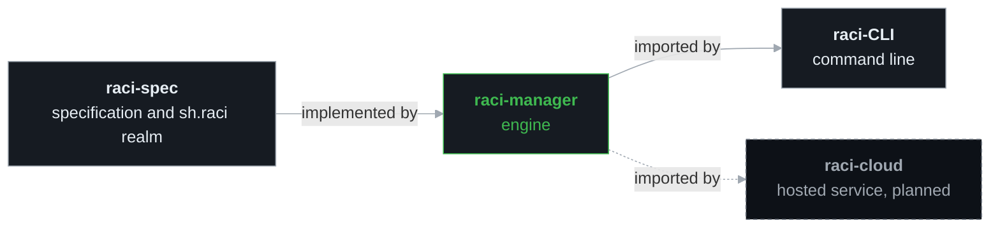

# Reference

Platform context and packages of [raci-manager](../README.md). The specification is
[`SPEC.md`](https://github.com/raci-sh/raci-spec/blob/main/SPEC.md) in raci-spec; section
numbers (§) below refer to it.

## Architecture

The manager is the middle tier of RACI.sh:

Validation, hashing, the audit log, the `.raci` view and verification live here.
[raci-CLI](https://github.com/raci-sh/raci-CLI) imports the manager's public Go packages and
presents the results; the planned cloud service will import them too. Dependencies point from
consumers to the manager, never back, and the manager never depends on a cloud service.

A realm keeps two files side by side, both committed to the repository:

| File | Package | What it is |
| ---- | ------- | ---------- |
| `.raci.jsonl` | `eventlog` | The append-only audit log: one canonical JSON event per line, hash-chained through `prev_hash` (§4.2) |
| `.raci` | `view` | The materialised view: the realm's RACI as of the log head, rebuilt and checked by replay (§7) |

## Packages

Public packages live under `src/`, for example
`github.com/raci-sh/raci-manager/src/eventlog`. The
[Go API documentation](https://pkg.go.dev/github.com/raci-sh/raci-manager) lists every type and
function.

### Foundation

| Package | § | Description |
| ------- | - | ----------- |
| `model` | §1 | The RACI core model: realms, parties, activities, resources and the entries that bind a party to a set of roles for an activity on a resource. Roles are written in canonical A > R > C > I order, for example `"AR"`. |
| `canonical` | §4.1 | RFC 8785 canonical JSON (JSON Canonicalization Scheme). Every digest in the log and in the `.raci` file is computed over this form. |
| `digest` | §4.1 | Digests as `blake3:` followed by 64 lowercase hex characters, and the all-zero sentinel that starts a chain. |
| `event` | §4.1 | The audit event envelope, its type discriminator and one payload per type: entries, resources, constraints, rules, pins and commits. |

### Modules

| Package | § | Status | Description |
| ------- | - | ------ | ----------- |
| `eventlog` | §4.2 | works | A realm's audit log as one JSONL file next to its `.raci` file, with the CLI as its only writer. Reads, appends and verifies the hash chain. |
| `view` | §7 | replay to build | The `.raci` materialised view and its canonical ordering. `Replay` builds the empty view of an empty log and returns `ErrNotImplemented` for any events. |
| `constraint` | §2 | names only | Strictness constraints, switched on per realm and tighten-only, the strict preset and conflict pairs. Evaluation is to be built. |
| `inference` | §3.1 | vocabulary only | Inference rules: a rule fires on an operation for a target resource type and produces role deltas through `map`, `add-issuer` and `strip` actions. Inference is non-recursive. The engine is to be built. |
| `verify` | §7.1 | chain only | The verification report and its finding codes. `Log` checks the hash chain; view, rule and change checks are to be built. Findings are computed on demand and never persisted. |

The `raci-manager` binary under `src/cmd/raci-manager` only prints its version: the library is
the product.
